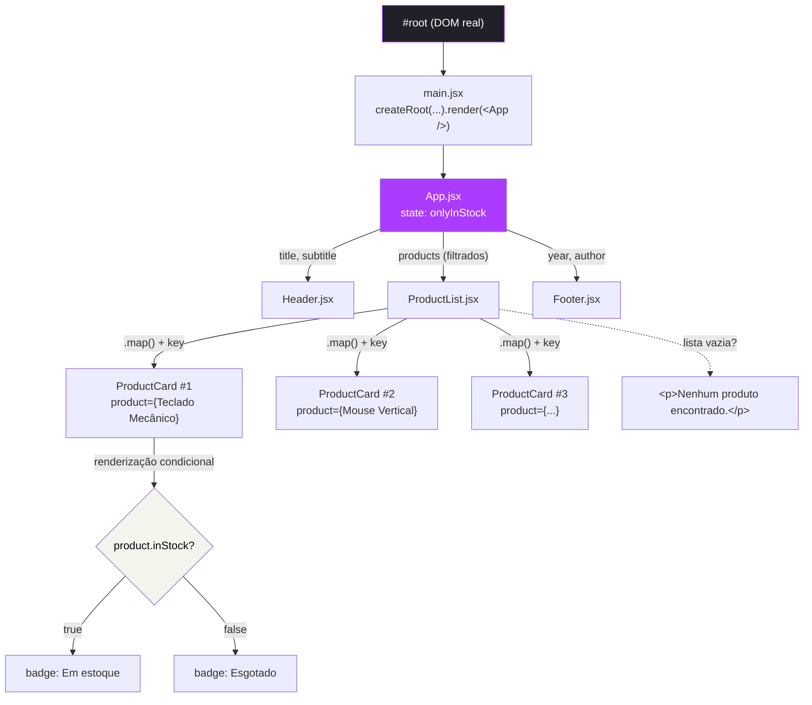

# Projeto Conceito React

Projeto simples criado com **React + Vite** para demonstrar, na prática, os conceitos fundamentais da biblioteca: arquivos JSX, componentes, props, listas com `.map()` e renderização condicional.

A aplicação é um catálogo de produtos: exibe uma lista de itens, mostra se cada um está em estoque e permite filtrar para ver apenas os disponíveis.

## Funcionalidades

- Exibição de um catálogo de produtos (nome, preço formatado em R$ e status de estoque).
- Botão para alternar entre "mostrar todos os produtos" e "mostrar apenas os em estoque".
- Badge visual ("Em estoque" / "Esgotado") que muda de acordo com os dados de cada produto.
- Mensagem alternativa quando a lista filtrada fica vazia.
- Rodapé com informações dinâmicas recebidas via props.

## Conceitos de React utilizados

| Conceito | Onde está no código |
| --- | --- |
| **Arquivo JSX** | Todos os componentes (`src/App.jsx`, `src/components/*.jsx`) são escritos em arquivos `.jsx`, misturando HTML e JavaScript. |
| **Componentes** | A interface é dividida em `Header`, `ProductList`, `ProductCard` e `Footer`, cada um responsável por uma parte da UI. |
| **Props** | `Header` recebe `title`/`subtitle`, `ProductList` recebe `products`, `ProductCard` recebe `product` e `Footer` recebe `year`/`author`. |
| **Listas com `.map()` e `key`** | Em `ProductList.jsx`, o array de produtos é percorrido com `.map()` para renderizar um `ProductCard` por item, cada um com uma `key` única (`product.id`). |
| **Renderização condicional** | O badge de estoque usa operador ternário (`product.inStock ? ... : ...`); `ProductList` retorna uma mensagem alternativa se a lista estiver vazia; o texto do botão de filtro muda conforme o estado `onlyInStock`. |
| **Estado (`useState`)** | `App.jsx` guarda o estado `onlyInStock`, que controla a lista filtrada passada como prop para `ProductList`. |

## Estrutura do projeto

```
src/
├── main.jsx              # Ponto de entrada: monta <App /> no DOM
├── App.jsx                # Componente raiz: guarda o estado e distribui as props
├── App.css
├── index.css
├── data/
│   └── products.js        # Dados estáticos dos produtos
└── components/
    ├── Header.jsx          # Recebe title/subtitle via props
    ├── ProductList.jsx     # Recebe products[], faz o .map() e a renderização condicional da lista vazia
    ├── ProductCard.jsx     # Recebe product via props, renderiza o badge condicional
    └── Footer.jsx          # Recebe year/author via props
```

## Mapa da árvore de componentes (Virtual DOM)

O diagrama abaixo representa como o React monta a árvore do Virtual DOM a partir dos componentes, mostrando quais props cada um recebe e como a lista é expandida dinamicamente pelo `.map()`.



## Como executar

```bash
npm install
npm run dev
```

A aplicação ficará disponível em `http://localhost:5173` (porta padrão do Vite).

Outros comandos disponíveis:

```bash
npm run build    # gera a versão de produção em dist/
npm run preview  # serve o build de produção localmente
npm run lint      # roda o ESLint no projeto
```

## Tecnologias

- [React](https://react.dev/) 19
- [Vite](https://vite.dev/) 8
- JavaScript + JSX (sem TypeScript, para manter o foco nos conceitos básicos do React)
